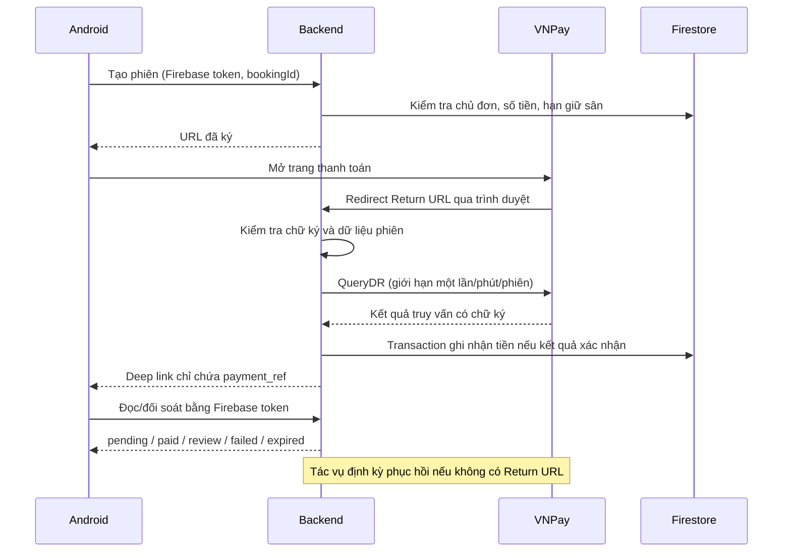

# VNPay Sandbox khi chưa cấu hình được IPN

## Giải pháp của đồ án

Backend tạo và ký URL bằng số tiền của đơn trong Firestore. Android chỉ mở
trang thanh toán. Return URL về backend được kiểm tra chữ ký, merchant,
reference và số tiền của phiên; sau đó kích hoạt QueryDR. **Chỉ kết quả
QueryDR đã xác minh hoặc IPN hợp lệ mới được dùng để ghi nhận tiền.**
Email VNPay là tài liệu hỗ trợ đối soát thủ công, không phải nguồn tự động
cập nhật database. IPN vẫn được giữ để dùng khi merchant được cấu hình.

## Hành vi và giới hạn

- Phiên mới chờ tối thiểu 60 giây trước QueryDR. Return URL, app và tác vụ
  dùng chung giới hạn truy vấn bằng transaction; tải lại callback không tạo
  các truy vấn ngân hàng liên tiếp.
- Return URL vẫn chuyển về app nếu truy vấn lỗi. App tự kiểm tra mỗi 10 giây,
  tối đa 12 lượt sau callback hoặc trạng thái pending; backend mới quyết định
  có cần gọi VNPay không. Lỗi mạng/HTTP 5xx được thử lại trong giới hạn này.
  Sau đó người dùng có thể bấm Kiểm tra lại.
- Hủy, mất mạng hoặc đóng app không chứng minh chưa trả tiền. Không ghi paid
  từ deep link và không tự tạo phiên thanh toán thay thế.
- Khi app bị đóng hẳn, tác vụ đối soát định kỳ là bắt buộc để tự phục hồi.
  Chạy tác vụ theo [hướng dẫn vòng đời](VNPAY_LIFECYCLE.md).
- Giữ sân tối đa 15 phút theo chính sách hiện có. Tiền về sau khi sân đã nhả
  được ghi nhận và đánh dấu review; không giành lại sân của người khác.
- Đã thanh toán và chủ sân đã duyệt là hai trạng thái độc lập. Hoàn tiền
  tự động chưa được triển khai.

## Nghiệm thu trước báo cáo

1. Cấu hình merchant Sandbox, secret, HTTPS Return URL và VNPAY_SERVER_IP
   trên backend. Không đưa secret vào Android.
2. Thử QueryDR với giao dịch Sandbox thực tế. Unit test mock không chứng minh
   merchant đã được VNPay cho phép truy vấn.
3. Chạy dry-run tác vụ, kiểm tra đơn cũ trước khi bật chế độ apply và lịch
   chạy mỗi phút. Kiểm tra log/exit code và các phiên chưa đối soát được.
4. Thử thành công không IPN, hủy, mất mạng, tắt app sau trả tiền, callback
   giả/lặp lại và tiền về sau hết hạn. Đối chiếu Firestore và cổng Sandbox.
5. Xác nhận Firestore Rules đang triển khai cấm Android tự ghi paid.

Đoạn dùng trong báo cáo: “Do chưa cấu hình được IPN trong môi trường thực
nghiệm, hệ thống dùng Return URL làm tín hiệu kích hoạt truy vấn QueryDR từ
backend đến VNPay, kết hợp đối soát định kỳ. Kết quả thanh toán được kiểm tra
chữ ký và đối chiếu đơn trước khi cập nhật bằng transaction. Thiết kế không
phụ thuộc dữ liệu thành công do Android cung cấp; việc xác nhận có thể chậm
do giới hạn truy vấn hoặc gián đoạn mạng.”
